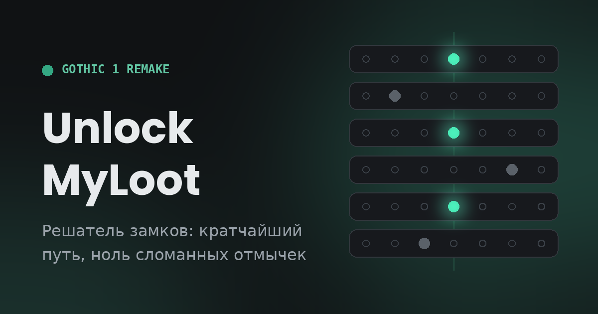

<div align="center">



# UnlockMyLoot

### Решатель замков для Gothic 1 Remake — кратчайший путь, ноль сломанных отмычек

[**unlockmyloot.com →**](https://unlockmyloot.com) · [English](https://unlockmyloot.com/en/) · [Каталог замков](https://unlockmyloot.com/locks/)


</div>

---

## Зачем это

Мини-игра взлома замков в Gothic 1 Remake — головоломка-слайдер: у каждой плитки семь отверстий, штифт должен встать в центральное (позиция 4). Ловушка в том, что плитки связаны: двигаешь одну — едут другие, иногда в противоположную сторону. А любое движение в стену напрягает отмычку, и после пары ошибок она ломается.

UnlockMyLoot перебирает все состояния замка и выдаёт **кратчайшую последовательность ходов, в которой ни один штифт ни разу не упирается в стену**. Следуй шагам — отмычка целее, лут твой.

## Как пользоваться

Открой [сайт](https://unlockmyloot.com), дальше три шага:

1. **Количество плиток** — от 3 до 8, в игре обычно 6.
2. **Позиции штифтов** — кликни на текущее отверстие каждой плитки (счёт слева направо, центр — 4).
3. **Связи между плитками** — вручную в матрице или через **«Помощь»** на шаге 03: мастер даёт безопасный ход в игре, ты отмечаешь, кто дёрнулся, связи записываются сами. Если стартовые штифты совпали с известным замком из каталога, мастер предложит его связи и сверит их пробами. При открытии помощника снимается снимок исходных штифтов; в UI остаются позиции после проб (как в игре), а в общую копилку (после «Сайт помог? → Да») уходит конфигурация **исходные штифты + найденные связи**.

Жми **«Взломать»** — получишь пронумерованные шаги с предпросмотром позиций после каждого хода. Выполненные шаги отмечаются кликом. Конфигурацию можно отправить другу ссылкой `?lock=…` или найти готовые замки в [каталоге](https://unlockmyloot.com/locks/). Счётчик на главной показывает, сколько замков уже вскрыто всеми посетителями.

## Как это работает

Состояние замка — вектор позиций штифтов, ход — сдвиг плитки с каскадом по связям. Решатель в два этапа: **BFS** находит минимальное число ходов среди безопасных (штифт остаётся в [1, 7]), затем **DP по коридору кратчайших путей** выбирает вариант с меньшим числом переключений между плитками. Перед выводом решение прогоняется через независимую симуляцию.

Мастер связей учитывает механику игры: если связанная плитка упёрлась бы в стену, весь ход не происходит; при блокировке у стены ищет обходной путь BFS по уже проверенным плиткам.

Алгоритм проверен на реальных замках (включая [дверь у основания Разрушенной башни](https://unlockmyloot.com/?lock=aUkAACUBAAJikA) в Старом Лагере) и на тысячах случайных конфигураций — тесты в папке `tests/`.

## API (Cloudflare Worker)

Статика на GitHub Pages, бэкенд — `api.unlockmyloot.com` (Durable Object + KV):

| Метод | Путь | Назначение |
| --- | --- | --- |
| `GET` | `/count` | Счётчик взломанных замков |
| `POST` | `/opened` | +1 к счётчику |
| `POST` | `/lock?code=…&pins=…` | Запись в копилку (код + фингерпринт штифтов) |
| `GET` | `/locks` | Топ конфигураций из копилки («Живой топ» в каталоге) |

Подсказки связей сайт берёт только из каталога (`locks.yaml`), а не из копилки: `/suggest` в воркере остался, но сайт его не вызывает.

## Устройство

```
site/               корень сайта: публикуется целиком
  index.html          решатель RU (разметка, стили, UI, мастер связей)
  en/index.html       решатель EN
  locks/              стили и фон страниц замков (lock-page.css/js)
  404.html, robots.txt, иконки, og.png, CNAME
locks.yaml          каталог замков - единственный источник списка
tools/
  build-locks.mjs     генератор: locks.yaml -> каталог, страницы замков, sitemap (в site/)
  lock-format.mjs     замок pins/links <-> код ссылки ?lock=
  lock-from-code.mjs  npm run lock -- <код>: код с сайта -> pins/links для locks.yaml
  templates/          шаблоны страниц каталога RU / EN
worker/             Cloudflare Worker: счётчик, копилка, аналитика, отзывы
  counter-worker.js, wrangler.toml
  scripts/            сводка воронки и сброс оценок (нужен STATS_SECRET)
tests/              регрессионные тесты решателя, мастера, ссылок, подсказок
docs/               внутренние заметки (locks-research.md), на сайт не попадают
.github/workflows/  деплой сайта (pages.yml), воркера (worker.yml), очистка копилки (purge-locks.yml)
```

В `site/` собираемые файлы (`site/locks/*`, `site/en/locks/`, `site/sitemap.xml`) в git не хранятся: их создаёт `npm run build:locks`.

Хостинг разнесён сознательно: статика на **GitHub Pages** (доступен без VPN в РФ), API — **Cloudflare Worker**. Если API недоступен, сайт молча показывает локальный fallback счётчика и работает дальше.

Если основной домен не открывается, в подвале есть **зеркало** на jsDelivr (`gcore.jsdelivr.net`). Зеркало `1h8s.github.io` не подходит: GitHub Pages с кастомным доменом редиректит обратно на `unlockmyloot.com`. Зеркало отдаёт файлы прямо из git, поэтому собранного каталога там нет: решатель работает, но без подсказок по известным замкам.

Каждый пуш в `main` собирает каталог из `locks.yaml` и деплоит сайт (GitHub Actions), а также воркер (Cloudflare Workers Builds, корневая папка — `worker/`). **Не менять** `id` KV в `worker/wrangler.toml` — оттуда подтягивается значение счётчика при миграции.

## Запуск локально

Решатель работает без сборки (`open site/index.html`). Каталог, страницы замков и подсказки по известным замкам собираются из `locks.yaml`, в git их нет:

```bash
npm install           # один раз: пакет yaml для генератора
npm run serve         # собрать каталог и открыть сайт на http://localhost:8000
# или по шагам:
npm run build:locks   # собрать каталог из locks.yaml в site/
python3 -m http.server 8000 -d site
# тесты
npm test
```

## Как добавить или поправить замок

1. Допиши или исправь запись в `locks.yaml` (поля описаны в начале файла). Замок задаётся явно — штифты и связи:
   ```yaml
   - slug: scatty-chest
     pins: [6, 3, 2, 1, 7]   # стартовые позиции, плитки 1..5
     links:                  # двигаю плитку: кто едет (+ та же сторона, - противоположная)
       1: +4
       4: +2 -3 -5
   ```
   Если замок уже решён на сайте, возьми код из ссылки `?lock=…` и выполни `npm run lock -- <код>` — команда выведет готовые `pins` и `links` и скажет, если такой замок уже есть в каталоге. Код для ссылок, число ходов и связей генератор считает сам.
2. Проверь локально: `npm run build:locks` — при ошибке (неверные штифты или связи, замок не решается, занятый адрес, не заполнен обязательный текст) сборка остановится и скажет, что не так.
3. Закоммить `locks.yaml` — при деплое CI соберёт каталог и страницы сам.

## Авторство и лицензия

Сайт создан YouTube-каналом [**108 seconds**](https://www.youtube.com/@1h8s).

Метод пошагового определения связей между плитками (мастер «Помощь»: двигаешь плитку — отмечаешь, кто дёрнулся — связи и позиции вычисляются автоматически) впервые придуман и реализован в этом проекте, июнь 2026.

Код распространяется под лицензией [**AGPL-3.0**](LICENSE). Коротко: использовать и модифицировать можно, но любой сайт или сервис на основе этого кода обязан открыть свой исходный код под той же лицензией и сохранить указание авторства. Хочешь использовать иначе — напиши, договоримся.

Фанатский инструмент для [Gothic 1 Remake](https://gothicthegame.com/) (Alkimia Interactive / THQ Nordic). Не аффилирован с разработчиками или издателем — просто очень не хотелось ломать отмычки.
